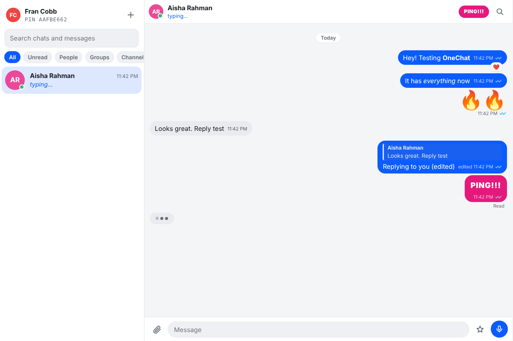
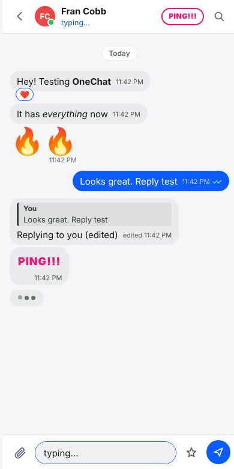

# OneChat

One messenger that takes the best idea from each of the big four and puts them in one place.



## What it borrows, and from whom

**BlackBerry Messenger**
- 8 character PIN instead of a phone number. Share the PIN, people add you. No number leaks.
- `PING!!!` button in every one-to-one chat. Shakes their screen, buzzes their phone, beeps.
- Optional D / R receipts (Settings → Read receipts style) for the old school crowd.
- Status line under your name ("At the gym", "In a meeting").

**WhatsApp**
- ✓ sent, ✓✓ delivered, blue ✓✓ read. Messages sent while someone is offline flip to delivered the moment they come back.
- Voice notes (tap the mic, tap again to send, or cancel).
- Reply with a quote, tap the quote to jump to the original.
- Delete for everyone (leaves a "message was deleted" tombstone).
- Disappearing messages: 30s, 1h, 24h, 7d or 90d per chat.
- Star messages, then find them all under the ★ Starred filter.
- `*bold*`, `_italic_`, `~strike~` and `` `code` `` formatting.
- "Message info" shows exactly who has read and who it's delivered to in groups.

**Telegram**
- Your account lives on the server, so you sign in on any number of devices with PIN + password and everything syncs.
- Edit sent messages (right-click → Edit, or press ↑ in an empty box).
- Channels: you broadcast, subscribers read and react but can't post.
- Invite codes to join groups and channels.
- Pinned message bar at the top of a chat.
- Send silently (no notification for them).
- Search across every chat from the sidebar, or inside one chat.
- Drafts are kept per chat.

**iMessage**
- Tapbacks: ❤️ 👍 👎 😂 ‼️ ❓ (right-click or long-press). Double-click a bubble for a quick ❤️.
- Send with effect: Slam, Loud, Gentle, Confetti.
- Typing bubble with the bouncing dots, plus "Delivered" / "Read" under your last message.
- Emoji-only messages show big.

Also: offline outbox, image paste, photo compression, profile photos, light/dark theme, desktop notifications (while the tab is open), works on phone screens.



## Run it

```bash
cd messenger
npm install
npm start
# open http://localhost:3000 in two browsers (or one normal, one private window)
```

Create an account in each, copy one PIN, hit **+ → Add by PIN** in the other. That's it.

Env vars (all optional):

| Var | Default | What |
|---|---|---|
| `PORT` | `3000` | HTTP + WebSocket port |
| `DATA_FILE` | `messenger/data.json` | Where accounts, chats and messages are saved |

## Tests

```bash
npm test
```

Boots the server on a random port and drives it with real sockets: sign-up and multi-device login, the full DM cycle (send, delivered, read, react, edit, delete), offline delivery, channel permissions and invites, disappearing messages, PING and typing.

## Deploying

It's a single Node process with no database, so it runs anywhere Node does. On Railway, make a second service from this repo, set its root directory to `messenger`, and it'll pick up `npm start`. Attach a volume and point `DATA_FILE` at it, or your history resets on every deploy.

## Honest limits (what's next)

This is a working MVP, not a WhatsApp competitor yet. The gaps that matter:

1. **No end-to-end encryption.** Messages are stored in plain JSON on the server. Fine for you and friends on your own server. Before strangers use it, add the Signal protocol (libsignal) so the server only ever sees ciphertext.
2. **JSON file storage.** Good to a few thousand messages. Swap to SQLite or Postgres before it grows.
3. **Media goes over the socket as data URLs**, capped at 3 MB. Real apps upload to object storage (S3/R2) and send a link.
4. **No voice/video calls.** WebRTC is the next big piece.
5. **No push when the tab is closed.** Needs a service worker + Web Push, or native apps.
6. **Stories / Status updates** and **bots** (Telegram's killer feature) aren't in yet. The Fran assistant bot in the repo root is the obvious first bot to plug in.
